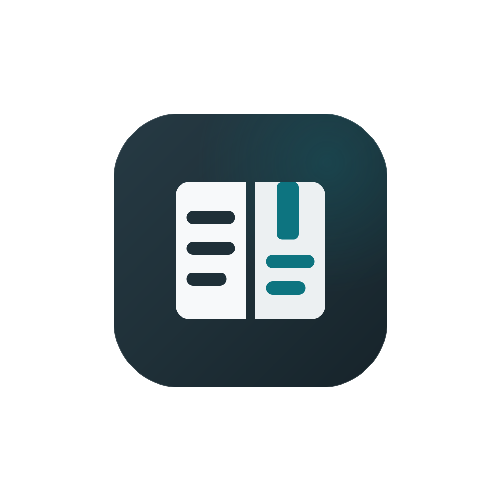
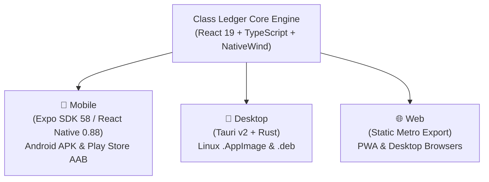

<div align="center">

  

  # 📚 Class Ledger

  ### **Student Treasury, Dues Tracking & Fine Management — Simplified.**

  An offline-first, privacy-focused financial management ledger crafted specifically for university class representatives, student councils, and class treasurers.

  <p align="center">
    <a href="https://github.com/0xkev21/class-ledger/releases/latest">
      
    </a>
    <a href="https://github.com/0xkev21/class-ledger/blob/main/LICENSE">
      
    </a>
    <a href="https://github.com/0xkev21/class-ledger/actions/workflows/release.yml">
      
    </a>
  </p>

  <p align="center">
    
    
    
    
    
  </p>

  <p align="center">
    <a href="https://github.com/0xkev21/class-ledger/releases/latest"><strong>📱 Download APK</strong></a> •
    <a href="https://github.com/0xkev21/class-ledger/releases/latest"><strong>🐧 Download Linux App</strong></a> •
    <a href="#-key-features"><strong>✨ Key Features</strong></a> •
    <a href="#-quick-start"><strong>🚀 Quick Start</strong></a> •
    <a href="RELEASE.md"><strong>📦 Distribution Guide</strong></a>
  </p>

</div>

---

## 🌟 Overview

Managing university classroom funds, event donations, and disciplinary fines is traditionally messy—often lost across scattered paper notebooks, disjointed chat threads, and manual spreadsheets.

**Class Ledger** solves this with an intuitive, unified ledger designed from the ground up for class representatives and student treasurers. It works completely offline, protects student privacy, creates beautiful shareable graphic summaries for Viber and Telegram class groups, and offers optional encrypted cloud sync.

---

## ✨ Key Features

| Category | Highlights |
| :--- | :--- |
| 🎯 **Events & Dues Tracking** | Bulk-assess mandatory fees or collect voluntary donation drives across your class roster with 1-tap contribution tracking and real-time total rollups. |
| ⚖️ **Subject-Wise Fines** | Organize attendance, late homework, and classroom discipline fines by academic subject. Track paid vs. outstanding balances effortlessly. |
| 🖼️ **Aesthetic Visual Reports** | Generate high-resolution, beautifully styled PNG & SVG report cards, payment receipts, and donor summaries ready to drop directly into chat groups. |
| ⚡ **Offline-First by Design** | 100% fully functional without any internet connection. All data persists safely on local device storage. |
| ☁️ **Encrypted Cloud Sync** | Optional multi-tenant cloud sync powered by Supabase with Row Level Security (RLS). Sign in via Google or Email to sync across devices. |
| 🇲🇲 **Bilingual & Local Payments** | Full native support for English and Myanmar (Burmese) with localized currency (MMK), Burmese numerals, and KBZPay/WavePay broadcast formatting. |
| 📊 **Safe Data Portability** | Export and import full JSON database backups and CSV spreadsheets sanitized against CSV formula injection attacks (`=`, `+`, `-`, `@`). |
| 🎨 **Expressive Themes** | 9 hand-crafted color palettes (Classic Indigo, Ocean Blue, Emerald, Violet, Rose, etc.) with seamless automatic Light and Dark mode. |

---

## 📱 Platform Availability

Class Ledger is built with universal cross-platform architecture:



### 📥 Downloads

| Platform | Format | Size | Details |
| :--- | :--- | :--- | :--- |
| **Android (arm64-v8a)** | `.apk` | ~15 MB | Recommended for >95% of modern phones |
| **Android (Universal)** | `.apk` | ~42 MB | Compatible with all Android architectures |
| **Android App Bundle** | `.aab` | ~15 MB | Google Play Store distribution format |
| **Linux Desktop** | `.deb` | ~4.5 MB | Debian, Ubuntu, Linux Mint installer |
| **Linux Portable** | `.AppImage` | ~55 MB | Universal standalone Linux executable |
| **Web Browser** | Web App | Zero-install | Open in Chrome, Firefox, Safari, or Edge |

👉 **[Grab the latest binaries from GitHub Releases](https://github.com/0xkev21/class-ledger/releases/latest)**

---

## 🛠️ Tech Stack

- **Framework**: [Expo SDK 58](https://expo.dev/) with [Expo Router](https://docs.expo.dev/router/introduction/) (File-based navigation)
- **Runtime**: [React Native 0.88](https://reactnative.dev/) + [React 19](https://react.dev/) + [TypeScript](https://www.typescriptlang.org/)
- **Desktop Wrapper**: [Tauri v2](https://tauri.app/) (Rust-based lightweight desktop webview)
- **Styling**: [NativeWind v4](https://www.nativewind.dev/) + [Tailwind CSS](https://tailwindcss.com/)
- **Icons & Motion**: [Lucide Icons](https://lucide.dev/), [Expo Symbols](https://docs.expo.dev/versions/latest/sdk/symbols/), [React Native Reanimated](https://docs.swmansion.com/react-native-reanimated/)
- **Database & Sync**: Local storage + [Supabase](https://supabase.com/) PostgreSQL with RLS
- **CI/CD Automation**: GitHub Actions building Android APKs, Tauri Linux bundles, and Web exports on every tag

---

## 🚀 Quick Start

### Prerequisites
- [Node.js](https://nodejs.org/) (v20 or v22 recommended)
- `npm` or `bun`
- [Rust](https://www.rust-lang.org/) (only if building desktop apps with Tauri)

### 1. Clone & Install
```bash
git clone https://github.com/0xkev21/class-ledger.git
cd class-ledger
npm install
```

### 2. Environment Setup (Optional)
Copy the example environment configuration:
```bash
cp .env.example .env
```
*(Supabase credentials are required only if testing cloud synchronization. The app runs 100% standalone locally without them!)*

### 3. Run Development Server
```bash
# Start Expo development server (interactive menu)
npm start

# Run on Android emulator / USB device
npm run android

# Run in Web browser
npm run web

# Run Linux Desktop App (Tauri)
npm run tauri dev
```

### 4. Build & Verify
```bash
# Typecheck TypeScript
npm run typecheck

# Export static web bundle
npm run export:web

# Regenerate all brand icons and splash screens
python3 scripts/generate-assets.py
```

---

## 📂 Project Structure

```text
class-ledger/
├── app/                      # Expo Router navigation routes
│   ├── (tabs)/               # Main bottom-tab screens (Dues, Roster, Fines, Reports, Settings)
│   ├── landing.tsx           # Product showcase landing page
│   ├── modal.tsx             # Universal transaction & payment modal
│   └── _layout.tsx           # Root navigation stack & theme provider
├── assets/
│   ├── images/               # App icons, splash screens, adaptive icons, favicons
│   └── fonts/                # SpaceMono and custom typefaces
├── components/               # Shared UI component library
├── src/
│   ├── context/              # TreasuryContext & state management
│   ├── storage/              # SQLite & AsyncStorage offline persistence
│   ├── theme/                # Material 3 color presets & design tokens
│   ├── i18n/                 # English and Myanmar localization dictionaries
│   └── utils/                # Sanitized CSV, PDF/PNG export, and payment helpers
├── src-tauri/                # Tauri v2 desktop application bundle (Rust)
├── scripts/                  # Brand asset generation and build helpers
├── fastlane/                 # Store listing metadata (F-Droid & Play Store)
└── .github/workflows/        # Automated release and packaging CI/CD pipeline
```

---

## 🛡️ Privacy & Security

- 🔒 **Zero Telemetry**: No third-party behavioral analytics, ad trackers, or invasive analytics SDKs.
- 🔐 **Isolated Cloud Multi-Tenancy**: When cloud sync is active, records are strictly protected with Supabase Row Level Security—users can only read and write their own classrooms.
- 🛡️ **Sanitized CSV Exports**: Automated formula neutralization prevents malicious injection (`=cmd`, `@SUM`, etc.) when exported files are opened in Microsoft Excel or Google Sheets.

---

## 📄 License

This project is licensed under the **MIT License** — see the [LICENSE](LICENSE) file for details.

---

<div align="center">
  <sub>Built with ❤️ for University Class Treasurers & Student Councils worldwide.</sub>
</div>
